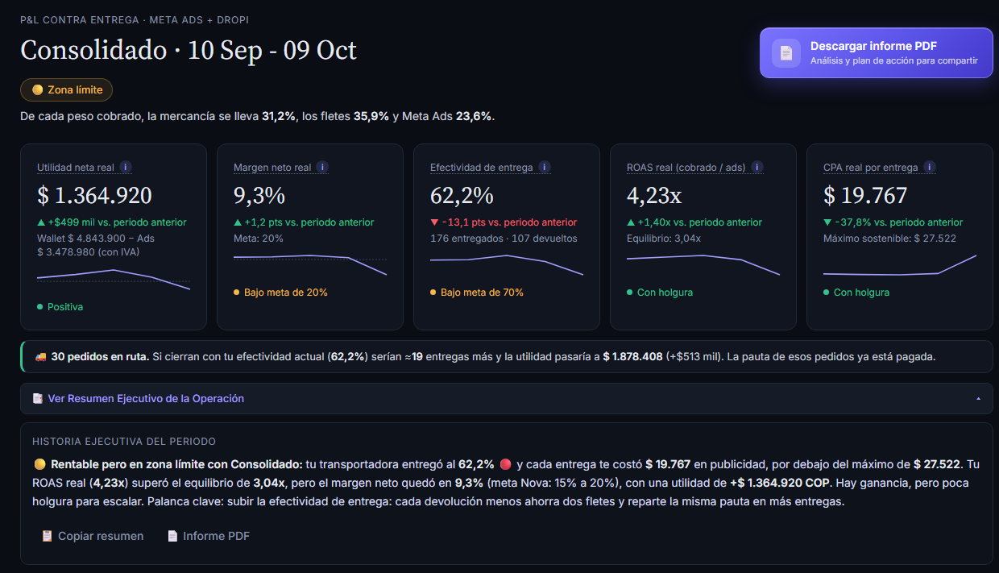
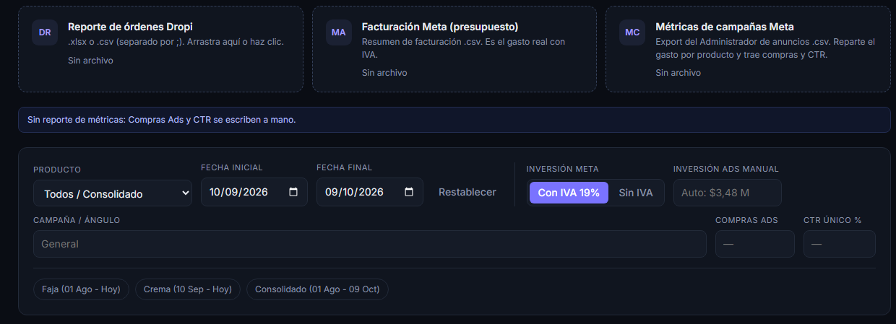
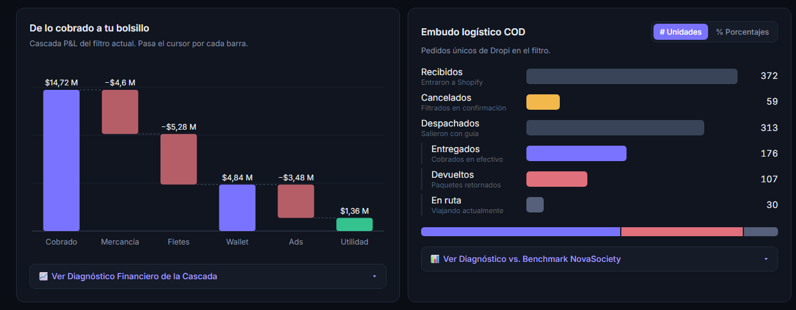
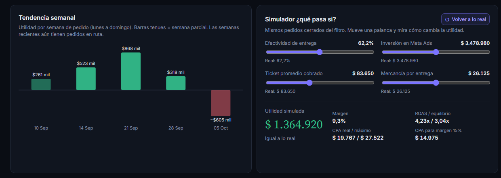
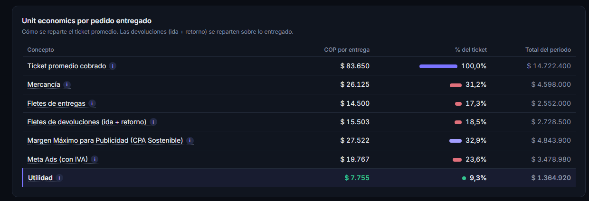
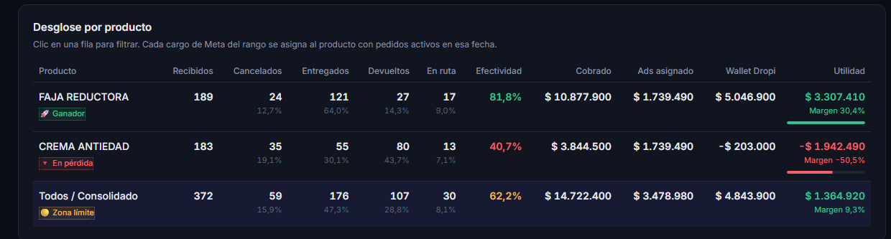
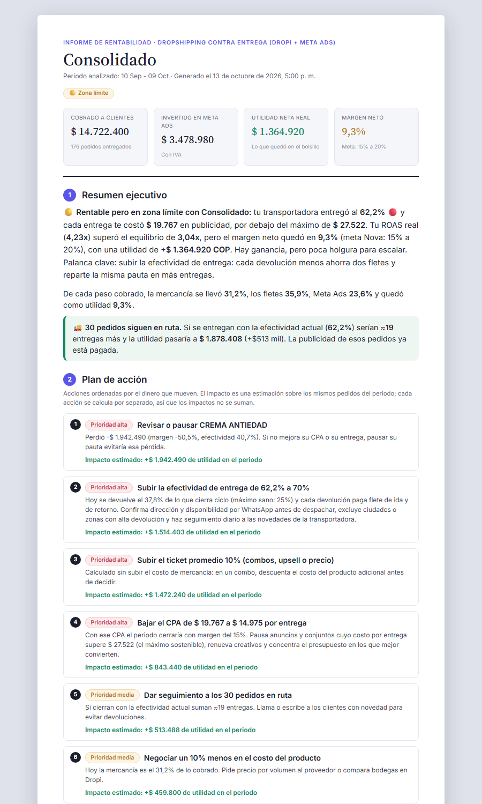

<div align="center">

# 💸 Dropshipping COD · Calculadora de Utilidad Real

### ¿Cuánta plata te dejó de verdad tu tienda contra entrega?

Cruza tus pedidos de **Dropi** con lo que pagaste en **Meta Ads** y te dice, en segundos,<br>
cuánto ganaste, por qué, y qué palanca mover para ganar más.


<br>



<sub>Capturas con datos de ejemplo.</sub>

</div>

---

## 📚 Contenido

- [✨ Qué hace en 30 segundos](#-qué-hace-en-30-segundos)
- [🚀 Empieza en 3 pasos](#-empieza-en-3-pasos)
- [📂 Los archivos que necesitas](#-los-archivos-que-necesitas)
- [🧭 Recorrido por el tablero](#-recorrido-por-el-tablero)
- [🧮 Cómo se calcula tu utilidad](#-cómo-se-calcula-tu-utilidad)
- [🎯 Metas NovaSociety y semáforos](#-metas-novasociety-y-semáforos)
- [💾 Guardar y compartir](#-guardar-y-compartir)
- [🔒 Privacidad](#-privacidad)
- [❓ Preguntas frecuentes](#-preguntas-frecuentes)
- [🛠️ Para desarrolladores](#️-para-desarrolladores)
- [✒️ Autor](#️-autor)
- [🎁 Propósito y agradecimientos](#-propósito-y-agradecimientos)
- [📜 Créditos y contacto](#-créditos-y-contacto)

---

## ✨ Qué hace en 30 segundos

En contra entrega (COD) lo que vende Meta **no** es lo que entra a tu bolsillo: hay cancelaciones, devoluciones, fletes de ida y vuelta, y pedidos que siguen en ruta. Esta app hace la cuenta completa por ti.

| | |
|---|---|
| 💰 **Utilidad real** | Lo que queda de verdad después de mercancía, fletes, devoluciones y publicidad. |
| 🚦 **Veredicto al instante** | Cada producto y periodo sale como 🚀 Ganador, 🟡 Zona límite, ⚖️ Equilibrio o 🔻 En pérdida. |
| 📈 **¿Voy mejorando?** | Cada indicador se compara con el periodo anterior y muestra su tendencia semana a semana. |
| 🚚 **Plata en camino** | Estima cuánto sumarán los pedidos que todavía están en ruta. |
| 🎛️ **Simulador** | Mueve efectividad, inversión en Ads, ticket o costo de mercancía y mira la utilidad cambiar en vivo. |
| 📑 **Historia en palabras** | Un párrafo que explica qué pasó y cuál fue la causa principal. Listo para copiar a WhatsApp. |
| 📄 **Informe PDF** | Un documento listo para enviar, con plan de acción priorizado e impacto estimado en pesos. Se entiende sin abrir la app. |
| 📊 **Excel consolidado** | Guarda cada periodo como una fila en tu archivo histórico de 20 columnas. |

---

## 🚀 Empieza en 3 pasos

> [!TIP]
> No hay que instalar nada. Es una página web que corre en tu propio navegador.

**1. Abre la app** → haz **doble clic** en `index.html`. Se abre en tu navegador (recomendado: **Chrome** o **Edge**).

**2. Arrastra tus reportes** → suelta los archivos de Dropi y Meta en las zonas de carga. No importa en qué cuadro los sueltes: la app reconoce cada archivo por su contenido y lo pone en su lugar.

**3. Lee tu tablero** → elige producto y fechas arriba. Todo se recalcula al instante.

> [!NOTE]
> La primera vez necesitas internet: la app descarga la librería que lee archivos Excel y las tipografías. Tus datos nunca se envían a ningún lado.

---

## 📂 Los archivos que necesitas

<p align="center"></p>

| Archivo | ¿De dónde lo saco? | ¿Qué aporta? | ¿Obligatorio? |
|---|---|---|:---:|
| 📦 **Reporte de órdenes Dropi** <br><sub>`.xlsx` o `.csv` separado por `;`</sub> | Dropi → Reportes → Órdenes | Pedidos, estados, cobrado, costo de proveedor y fletes | ✅ Sí |
| 💳 **Facturación de Meta** <br><sub>`.csv`</sub> | Meta → Facturación → Transacciones | El gasto **real** cobrado a tu tarjeta, día a día (con IVA) | ⭐ Muy recomendado |
| 📣 **Métricas de campañas** <br><sub>`.csv`</sub> | Administrador de anuncios → Exportar (mejor con desglose por **Día**) | Reparto del gasto por producto, compras y CTR | Opcional |

<details>
<summary><b>🔎 ¿Cómo interpreta la app cada archivo?</b></summary>

<br>

- **Dropi:** cada orden se clasifica por su `ESTATUS` en **entregada**, **devuelta**, **cancelada** (también rechazada o anulada) o **en ruta**. Los obsequios se suman al producto principal de su orden.
- **Facturación Meta:** en cuentas **prepago** solo cuenta el gasto descontado del saldo, no las recargas con tarjeta (si se sumaran ambos, la inversión saldría duplicada). Se omiten los cobros fallidos o reembolsados.
- **Métricas de campañas:** cada campaña se asigna a un producto de Dropi por su nombre. Si se equivoca, lo corriges en la tabla *Campañas Meta* y la app lo recuerda.
- **Sin facturación:** la inversión sale de las métricas de campañas × 1,19 (IVA).
- **Sin ningún archivo de Meta:** puedes escribir la inversión a mano en el filtro *Inversión Ads manual*.

</details>

---

## 🧭 Recorrido por el tablero

### 🎚️ 1. Filtros

| Control | Para qué sirve |
|---|---|
| **Producto** | Ver un producto o el consolidado. Al elegir uno, las fechas saltan a su ciclo real en Dropi. |
| **Fecha inicial / final** | El rango a analizar (por fecha del pedido). |
| **Con IVA 19% / Sin IVA** | *Con IVA* = lo que cobró la tarjeta. *Sin IVA* = el gasto bruto de Meta (cargo ÷ 1,19). |
| **Inversión Ads manual** | Reemplaza la inversión automática solo para este periodo. |
| **Campaña / Compras / CTR** | Datos que se guardan en el Excel consolidado. Si los dejas vacíos se usan los automáticos. |
| **Periodos rápidos** | Botones con el ciclo de cada producto. Si un producto tuvo obsequio, aparecen las etapas *antes* y *después*. |

### 🧾 2. Veredicto y tarjetas KPI

Arriba ves el **veredicto** del filtro y cómo se reparte cada peso cobrado entre mercancía, fletes y Meta Ads. Debajo, cinco tarjetas. Pasa el mouse por el ícono **ⓘ** de cada una para ver su explicación.

| Tarjeta | Qué te dice | Cómo leerla |
|---|---|---|
| 💰 **Utilidad neta real** | Lo que queda en tu bolsillo | Verde = ganas · Rojo = pierdes |
| 📊 **Margen neto real** | De cada $100 cobrados, cuántos son ganancia | Meta: **15% a 20%** |
| 🚚 **Efectividad de entrega** | De los pedidos que ya cerraron, cuántos se cobraron | Meta: **70%+** |
| 📈 **ROAS real** | Pesos cobrados por cada $1 en anuncios | Debe superar el **equilibrio** |
| 🎯 **CPA real por entrega** | Publicidad gastada por cada cliente que pagó | Debe ser menor al **máximo sostenible** |

Cada tarjeta trae además:

- **▲ / ▼ vs. periodo anterior:** compara con un rango de la misma duración justo antes. En verde si mejoró, en rojo si empeoró (en el CPA, bajar es mejorar). Pasa el mouse para ver las fechas y el valor anterior.
- **Comparación justa con pedidos en ruta:** si hay pedidos sin cerrar, la tarjeta de utilidad agrega una segunda línea que compara las utilidades **proyectadas** de ambos periodos. Así un periodo reciente no se ve peor solo porque aún no ha cobrado todo.
- **Mini-gráfica semanal:** la tendencia del indicador, semana a semana.
- **Semáforo:** el punto de color con el estado frente a la meta.

### 🚚 3. Pedidos en ruta

Si hay pedidos viajando, una franja te dice cuánto sumarían **si se entregan con tu efectividad actual**. La publicidad de esos pedidos ya está pagada, así que cada entrega extra es casi pura ganancia.

### 📑 4. Resumen ejecutivo

Un botón desplegable que conecta las cinco tarjetas en **un solo párrafo**: qué pasó, por qué y cuál fue la causa principal (pauta costosa, fletes de devolución o ambas). Hay una versión para cada escenario: ganador, zona límite, equilibrio y pérdida. Se reescribe solo cada vez que cambias producto o fechas. Desde ahí puedes **copiarlo** o generar el **informe PDF**.

### 📊 5. Cascada y embudo

<p align="center"></p>

- **De lo cobrado a tu bolsillo:** cada barra resta un costo hasta llegar a la utilidad. Abajo, el *Diagnóstico Financiero* evalúa cada paso contra su meta.
- **Embudo logístico COD:** recibidos → cancelados → despachados → entregados / devueltos / en ruta. Puedes verlo en **unidades** o en **porcentajes**, y abrir el *Diagnóstico vs. Benchmark* con su conclusión.

### 🎛️ 6. Tendencia semanal y simulador

<p align="center"></p>

- **Tendencia semanal:** utilidad por semana (lunes a domingo). Las barras tenues son semanas incompletas en el rango. Las semanas más recientes suelen verse peor porque aún tienen pedidos en ruta.
- **Simulador ¿qué pasa si?:** cuatro palancas sobre los mismos pedidos cerrados del filtro:

  | Palanca | Pregunta que responde |
  |---|---|
  | Efectividad de entrega | ¿Y si la transportadora entregara más? |
  | Inversión en Meta Ads | ¿Y si consigo los mismos pedidos gastando menos en anuncios? |
  | Ticket promedio | ¿Y si vendo combos o subo el precio? |
  | Mercancía por entrega | ¿Y si negocio mejor con el proveedor? |

  Muestra la utilidad simulada, su diferencia con lo real, el CPA resultante y el **CPA máximo para lograr un margen del 15%**. El presupuesto de Ads es total: si subes la efectividad, la misma inversión se reparte en más entregas y el CPA baja solo. Cuando mueves una palanca, el botón **↺ Volver a lo real** se ilumina.

> [!TIP]
> Si simulas un combo, sube el **ticket** *y también* la **mercancía por entrega**: el combo cuesta más producto.

### 🧩 7. Unit economics

<p align="center"></p>

Cómo se reparte el **ticket promedio** de un pedido entregado: mercancía, fletes, devoluciones, publicidad y utilidad. La fila clave es el **Margen Máximo para Publicidad (CPA sostenible)**: si tu publicidad por entrega lo supera, pierdes dinero.

### 🏷️ 8. Desglose por producto

<p align="center"></p>

Todos tus productos lado a lado, con su **veredicto** y una **barra de utilidad** para ver de un vistazo cuál escalar y cuál apagar. **Haz clic en una fila** para filtrar el tablero por ese producto.

### 📣 9. Campañas Meta

Aparece si cargas el reporte de métricas. Muestra gasto, compras, CPA de Meta y CTR por campaña, y te deja **cambiar el producto asignado** a cada una. Tus correcciones quedan guardadas en el navegador.

---

## 🧮 Cómo se calcula tu utilidad


| Indicador | Fórmula |
|---|---|
| **Wallet Dropi** | Cobrado − Mercancía − Fletes (entregas + devoluciones ida y retorno) |
| **Utilidad neta real** | Wallet − Meta Ads |
| **Margen neto** | Utilidad ÷ Cobrado |
| **Efectividad** | Entregados ÷ (Entregados + Devueltos) |
| **ROAS real** | Cobrado ÷ Meta Ads |
| **ROAS de equilibrio** | Cobrado ÷ Wallet |
| **CPA real** | Meta Ads ÷ Entregados |
| **CPA máximo sostenible** | Wallet ÷ Entregados |

> [!IMPORTANT]
> Las tres reglas de oro dicen lo mismo de tres formas: **pierdes dinero** cuando la utilidad es negativa, que es justo cuando el **CPA supera el máximo sostenible** y cuando el **ROAS queda por debajo del equilibrio**.

<details>
<summary><b>📐 ¿Cómo se reparte la inversión de Meta entre productos?</b></summary>

<br>

1. Se suman los cargos de facturación con fecha dentro del rango.
2. Cada cargo se asigna al producto que tenía **pedidos activos en esa fecha** (según su ciclo en Dropi).
3. Si dos productos estaban activos el mismo día, el cargo se divide según el gasto de sus campañas.
4. *Con IVA* usa el cargo de la tarjeta; *Sin IVA* lo divide entre 1,19.

</details>

---

## 🎯 Metas NovaSociety y semáforos

| Métrica | 🟢 Sano | 🟡 Atención | 🔴 Alerta |
|---|---|---|---|
| Margen neto | ≥ 15% *(ideal 20%)* | −2% a 15% | < −2% |
| Efectividad de entrega | ≥ 70% | 60% a 70% | < 60% |
| ROAS frente al equilibrio | ≥ 15% por encima | Apenas por encima | Por debajo |
| CPA frente al máximo | ≥ 15% por debajo | Apenas por debajo | Por encima |
| Tasa de devolución | ≤ 25% | > 25% | — |
| Cancelación en WhatsApp | 15% a 25% | < 15% o 25% a 30% | > 30% |
| Retención tras mercancía | ≥ 70% | < 70% | — |
| Wallet sobre lo cobrado | ≥ 45% | < 45% | — |
| Fletes sobre lo cobrado | ≤ 25% | 25% a 35% | ≥ 35% |
| Meta Ads sobre la Wallet | ≤ 60% | 60% a 100% | ≥ 100% |
| Efectividad global (entregados ÷ recibidos) | ≥ 60% *(Meta Reina)* | 50% a 60% | < 50% |

**Veredicto** del encabezado y de la tabla de productos:

| Veredicto | Cuándo aparece |
|---|---|
| 🚀 **Ganador** | Ganancia con margen de 15% o más |
| 🟡 **Zona límite** | Ganancia, pero con margen menor a 15% |
| ⚖️ **Equilibrio** | Margen entre −2% y +2% |
| 🔻 **En pérdida** | Utilidad negativa |

---

## 💾 Guardar y compartir

| Acción | Qué hace |
|---|---|
| 📊 **Guardar en consolidado** | Agrega la fila del filtro actual a tu `Utilidad_Consolidado_Global.xlsx` (hoja *Registro*, 20 columnas con fórmulas). La primera vez eliges el archivo o creas uno nuevo; la app lo recuerda. Si ya existe ese periodo + producto + campaña, te pregunta si sobrescribir o agregar. |
| 📤 **Exportar a Excel** | Descarga un Excel nuevo solo con la fila del filtro actual. |
| 🔁 **Cambiar archivo** | Vincula otro consolidado. |
| 📋 **Copiar resumen** | Copia título, veredicto, KPIs e historia en texto para pegar en WhatsApp o correo. |
| 📄 **Descargar informe PDF** | Botón arriba a la derecha: genera un informe completo para enviar a quien no tiene la app (ver abajo). |

### 📄 El informe PDF

<p align="center"></p>

Pulsa **📄 Descargar informe PDF** (el botón morado arriba a la derecha, o *Informe PDF* dentro del resumen ejecutivo) y, en la ventana de impresión, elige **Guardar como PDF**. El archivo se nombra solo con el producto y el periodo. Es un documento claro, en tamaño carta/A4, pensado para que un socio, inversionista o asesor entienda la operación **sin acceso a la app**:

| # | Sección | Qué contiene |
|:-:|---|---|
| — | **Portada** | Producto, periodo, veredicto y las 4 cifras clave: cobrado, invertido, utilidad y margen. |
| 1 | **Resumen ejecutivo** | La historia del periodo en palabras, cómo se repartió cada peso cobrado y la plata que viene en camino. |
| 2 | **Plan de acción** | Acciones ordenadas por el dinero que mueven, con prioridad y **utilidad extra estimada en pesos**. |
| 3 | **Indicadores clave** | Los 5 KPIs con su explicación, referencia, estado y cambio frente al periodo anterior. |
| 4 | **De lo cobrado al bolsillo** | La cascada en tabla con el diagnóstico financiero. |
| 5 | **Logística contra entrega** | El embudo de pedidos con el diagnóstico frente al benchmark. |
| 6 | **Economía por pedido** | Cuánto deja cada entrega y en qué se va. |
| 7 | **Tendencia semanal** | Utilidad, margen, ROAS y efectividad semana a semana. |
| 8 | **Resultado por producto** | Cada producto con su veredicto (si hay más de uno). |
| 9 | **Glosario y notas** | Qué significa cada término, más las fuentes y supuestos del cálculo. |
| — | **Firma** | Autor de la aplicación y fecha de generación del informe. |

> [!NOTE]
> Los impactos del plan de acción se calculan con el simulador: mismos pedidos cerrados del periodo, cambiando una sola variable a la vez. Por eso **no se suman** entre sí.

> [!WARNING]
> **Cierra el consolidado en Excel antes de guardar**: si está abierto, Windows bloquea el archivo y la app no puede escribirlo.
>
> Guardar directo sobre el archivo solo funciona en **Chrome o Edge**. En otros navegadores se descarga una copia actualizada para que reemplaces el original.

---

## 🔒 Privacidad

- 🖥️ Todo se procesa **dentro de tu navegador**. Tus reportes no se suben a ningún servidor.
- 💾 Lo único que la app guarda en tu navegador son tus asignaciones campaña → producto y el acceso a tu archivo consolidado.
- 🌐 Solo usa internet para descargar la librería de Excel y las tipografías.

---

## ❓ Preguntas frecuentes

<details>
<summary><b>¿Por qué la semana más reciente se ve tan mal?</b></summary>
<br>
Porque muchos de sus pedidos siguen en ruta: la publicidad ya se pagó pero el cobro todavía no llega. Mira la franja de <b>pedidos en ruta</b> para ver la utilidad proyectada.
</details>

<details>
<summary><b>No me aparece la comparación con el periodo anterior.</b></summary>
<br>
Solo se muestra si en el rango anterior (misma duración, justo antes) hubo pedidos cobrados. Si eliges todo el historial, no hay periodo anterior con qué comparar.
</details>

<details>
<summary><b>La inversión de Meta no me cuadra.</b></summary>
<br>
Revisa los avisos azules bajo las zonas de carga: indican si se excluyeron recargas prepago, cobros fallidos, gasto de campañas sin producto asignado o divisas distintas a COP. También verifica el botón <b>Con IVA / Sin IVA</b>.
</details>

<details>
<summary><b>Una campaña quedó asignada al producto equivocado.</b></summary>
<br>
En la tabla <b>Campañas Meta</b> cambia el producto en su lista desplegable. La app lo recuerda para la próxima vez.
</details>

<details>
<summary><b>¿El simulador cambia mis datos?</b></summary>
<br>
No. Es solo una calculadora de escenarios: nada de lo que muevas ahí afecta las tarjetas, el Excel ni el resto del tablero.
</details>

<details>
<summary><b>No puedo abrir archivos .xlsx.</b></summary>
<br>
La librería de Excel se descarga de internet. Abre la app con conexión; si no la tienes, exporta el reporte de Dropi como <code>.csv</code>.
</details>

---

## 🛠️ Para desarrolladores

<details>
<summary><b>Arquitectura, convenciones y pruebas</b></summary>

<br>

Sin build, sin servidor y sin dependencias npm. Única librería externa: [ExcelJS](https://github.com/exceljs/exceljs) por CDN.

### Capas

Cada capa solo usa las que están por encima en esta lista:

```
img/
  autor.png           Logo del autor (pie de la app y del informe)

css/
  base.css            Tokens de diseño, base, tarjetas, filtros y botones
  components.css      KPIs, gráficas, embudo, diagnósticos, simulador, tablas, avisos, impresión
  report.css          Informe PDF: documento claro en A4, visible solo al imprimir

js/
  core/               Lógica de negocio pura. Sin DOM: también corre en Node.
    parse.js          Texto normalizado, números locales, CSV, celdas de ExcelJS
    dates.js          Fechas ISO, etiquetas de periodo
    format.js         Formato es-CO (COP, %, x, montos compactos)
    dropi.js          Reporte de órdenes Dropi
    meta.js           Facturación y métricas de campañas Meta, asignación a producto
    pnl.js            Ciclos de producto, reparto de inversión, agregado del P&L
    diagnostics.js    Benchmarks del embudo y la cascada, historia ejecutiva, veredicto, semáforos KPI
    insights.js       Periodo anterior, semanas, proyección, simulador, unit economics, plan de acción
    excel.js          Plantilla y escritura del consolidado de 20 columnas
    index.js          Solo Node: exporta todo el núcleo para pruebas

  services/           Adaptadores a APIs del navegador
    storage.js        localStorage (asignaciones) e IndexedDB (archivo vinculado)
    files.js          Lectura de .xlsx/.csv, selector y descarga
    consolidado.js    Archivo consolidado con File System Access (Chrome/Edge)

  ui/                 Componentes que pintan el DOM. Reciben datos por parámetro.
    dom.js, tooltip.js, feedback.js, upload-zones.js, notices.js, trend.js,
    summary.js, cascade.js, funnel.js, diagnosis-panel.js, unit-table.js,
    simulator.js, products-table.js, campaigns-table.js, presets.js, report.js

  app/                Estado y casos de uso; conecta core, services y ui
    state.js          Estado único de la aplicación
    filters.js        Filtros, selección de producto, periodos rápidos
    data-loader.js    Carga de reportes y asignación campaña → producto
    save.js           Guardar en el consolidado, exportar, cambiar archivo
    report.js         Reúne el cálculo actual y genera el informe PDF
    main.js           render() y arranque. Va siempre de último.
```

### Convenciones

- **Sin `import`/`export`.** Los navegadores bloquean los ES modules en `file://`. Cada archivo es un IIFE que publica su API en el namespace global `PYL` (`PYL.core.pnl`, `PYL.ui.funnel`, etc.).
- **El orden importa.** `index.html` carga los scripts en el orden de las capas. Un archivo nuevo va en su capa, antes de los que lo usan.
- **Solo la capa `app` modifica el estado.** Los componentes de `ui` reciben datos y callbacks (`onSelect`, `onAssign`).
- **Los diagnósticos devuelven datos, no HTML.** El texto con negritas se representa como segmentos: un string es texto plano y `{ b: '...' }` va en negrita. `ui/dom.js` (`rich`) los pinta.

### Pruebas en Node

```js
const core = require('./js/core/index.js');
const dropi = core.buildDropi(core.parseCSV(texto));
const a = core.aggregate(dropi.lines, [], { prod: '__all', from: null, to: null, iva: true, adsOverride: null }, null);
```

</details>

---

## ✒️ Autor

¡Hola! Soy **Saul Echeverri Duque** 👨‍💻, creador y desarrollador de este proyecto. Te comparto un poco sobre mi formación y experiencia.

### 📚 Formación académica

- 📖 Tecnólogo en **Análisis y Desarrollo de Software** · SENA.
- 🎓 **Ingeniero de Alimentos** · Universidad de Antioquia, Colombia.
- 👨‍💻 Más de **4 años** de experiencia en desarrollo de microservicios con **Java, Spring Boot y Angular**.

### 💼 Trayectoria profesional

Desarrollador de software con sólida experiencia en el ecosistema Java y en soluciones enfocadas en productividad, escalabilidad y buenas prácticas de ingeniería. He aportado valor técnico en empresas del sector tecnológico y financiero:

| Empresa | Rol |
|---|---|
| 🏢 [IAS Software](https://www.ias.com.co/) | Desarrollador de Software Full Stack |
| 🏢 [Cidenet](https://cidenet.net/) | Analista de Desarrollo |
| 🏢 Convertic | Analista de Desarrollo |

### 🚀 Pasión por la programación

- 💻 Mi viaje en la programación comenzó en **2021** y desde entonces he estado inmerso en el universo del desarrollo de software.
- ☕ Mi principal área de enfoque es **Java**, pero este proyecto demuestra que las buenas prácticas (arquitectura por capas, código limpio, separación entre lógica y presentación) aplican en cualquier tecnología: aquí, en una app web con **HTML, CSS y JavaScript puro**.

---

## 🎁 Propósito y agradecimientos

Quiero expresar mi sincero agradecimiento a todas las personas y clientes que confían día a día en **[Vidanova 🍃]()**.

Este proyecto nace de la convicción de que la tecnología y la ingeniería de software deben ser aliadas directas del emprendimiento, transformando procesos manuales (como cruzar a mano reportes de Dropi y Meta en Excel) en flujos de trabajo ágiles, sin errores y altamente profesionales.

Esta herramienta representa no solo el control financiero real de mi tienda contra entrega, sino también un espacio continuo de aprendizaje y aplicación práctica de la ingeniería de software, demostrando que soluciones simples y bien diseñadas generan un impacto real e inmediato en el día a día de un negocio.

---

## 📜 Créditos y contacto

Este proyecto fue desarrollado por **[Saul Echeverri](https://github.com/saulolo)** con la finalidad de medir con precisión la rentabilidad de la operación contra entrega de mi tienda, pero aplicable a culesquier otra tienda que trabaje sobre este msmo model de negocio del Dropshipping.

Agradezco sinceramente el tiempo dedicado a revisar este proyecto. Valoro cualquier feedback técnico sobre las decisiones de arquitectura, diseño y buenas prácticas aplicadas, y quedo a disposición para profundizar en cualquier detalle de la implementación.

<div align="center">

[](https://github.com/saulolo)
[](mailto:saulolo@gmail.com)
[](https://www.linkedin.com/in/saul-echeverri-duque/)

</div>

---

### 📄 Metadatos del documento

| Campo | Detalles |
|:---|:---|
| **Título** | Dropshipping COD · Calculadora de Utilidad Real |
| **Autor** | Saul Echeverri |
| **Versión** | 1.0.0 |
| **Fecha de creación** | 12 de octubre de 2026 |
| **Última actualización** | 13 de octubre de 2026 |
| **Notas adicionales** | Aplicación web local (HTML, CSS y JavaScript sin dependencias de compilación) que cruza los reportes de Dropi y Meta Ads para calcular la utilidad real de una tienda contra entrega. |

---

<div align="center">
<sub>Hecho para la operación contra entrega de <b>Mi Tienda Online</b> · Colombia </sub>
</div>
